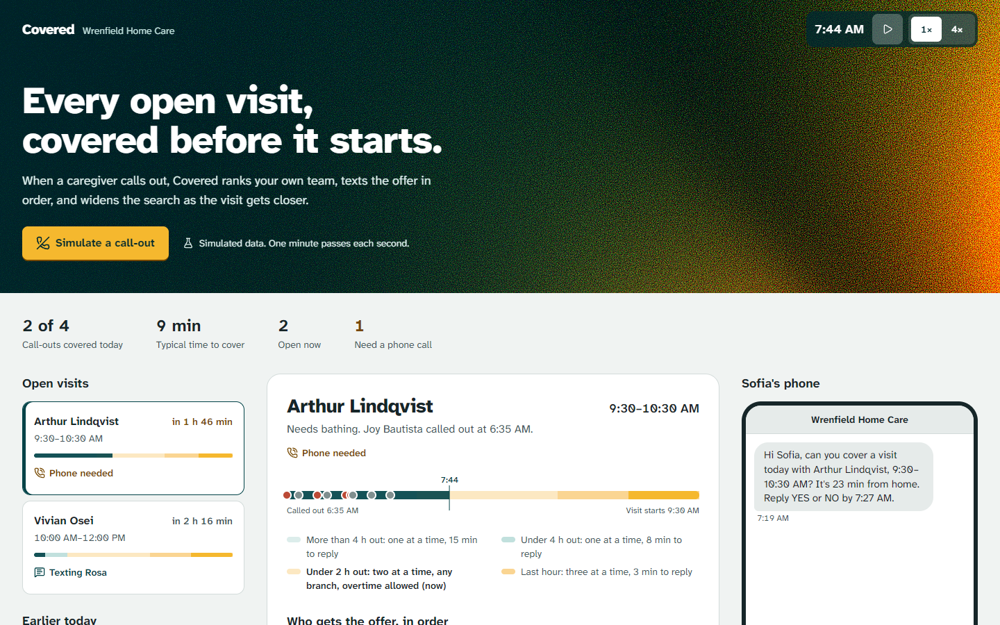

# Covered

Fills open home care visits after a call-out: ranks the agency's own caregivers, offers the visit in order, and escalates as the start time nears. Prototype with simulated data.

**[Open the live demo](https://josephfanpm.github.io/covered/)**



All clients, caregivers and visits are simulated. No real agency data is used.

## The problem

A home care visit happens in a client's home at a set time. When the caregiver calls out that morning, a scheduler has to find someone else before the client is left waiting. Today that usually means working down a list by phone.

Scheduling software can show the open visit and a shortlist of people who match. The slow part comes next: deciding who to ask first, asking them, waiting, and knowing when to stop waiting and try someone else. Covered is a prototype of that part.

## What it does

1. **Ranks the agency's own caregivers** for the open visit and shows why each one is where they are.
2. **Texts the offer in order.** The first YES gets the visit. Everyone else still holding an offer is told it's covered.
3. **Speeds up as the visit gets closer.** It asks more people at once, gives them less time to reply, and widens the search to other branches and overtime.
4. **Tells the scheduler when to pick up the phone**, and lets them assign someone by hand.
5. **Shows the day's numbers:** call-outs covered, typical time to cover, and what is still open.

## How the ranking works

Some things rule a caregiver out. The rest are scored out of 100.

**Ruled out if they:**

- have a visit that overlaps, or can't get from their previous visit in time
- would be late for their next visit
- aren't working today, or the visit falls outside their hours
- aren't trained for something the client needs
- are allergic to the client's cat
- called out themselves today

**Scored on:**

| Factor | Points | Why it matters in home care |
|---|---|---|
| Knows the client | 40 | A familiar caregiver is better care and an easier yes. The score rises fast over the first few visits and then levels off, so 12 visits is not worth much more than 6. |
| Short drive | 30 | Measured from where they will be, their previous visit that day, not from home. |
| Has hours left | 15 | Spreads work towards people with fewer hours and away from overtime. |
| Speaks the client's language | 15 | |

The weights are my starting assumptions. They are in one place (`src/sim/rank.ts`) so they are easy to change and test.

## How the offers escalate

| Time until the visit | Asked at once | Time to reply | Who can be asked |
|---|---|---|---|
| More than 4 hours | 1 | 15 min | Same branch, no overtime |
| 2 to 4 hours | 1 | 8 min | Same branch, no overtime |
| 1 to 2 hours | 2 | 5 min | Any branch, overtime allowed |
| Last hour | 3 | 3 min | Any branch, overtime allowed |

Under 30 minutes with nobody confirmed, or when there is nobody left to text, the visit is flagged for a phone call. If a branch runs out of people early, the search widens straight away.

Asking one person at a time far from the start protects continuity: the best match gets a fair chance to say yes. Close to the start, speed matters more than the perfect match.

## What is simulated, and what that means

- The agency, its 30 caregivers, 42 clients and about 50 visits are generated from a fixed seed, on an invented street grid. The day is identical on every load.
- Caregivers reply on their own unless you answer for them on the phone. How often and how fast they reply, and how likely they are to say yes, are assumptions I chose. A better match is more likely to say yes.
- So the fill rate and time to cover on screen describe this simulated day. They show how the product behaves. They are not evidence that the approach fills more visits.

## What I would test first with a real agency

1. **Does ordered texting fill visits faster than a scheduler phoning down the list?** Measure time to cover and fill rate against the current process.
2. **Are the weights right?** Compare who actually accepts against who was ranked first, then tune.
3. **Do the reply windows match how caregivers use their phones?** If most replies come within 4 minutes, a 15-minute window wastes time.
4. **Does widening to overtime cost more than a missed visit?** That is the agency's call, and the threshold should be theirs to set.

## Not built

- Real text messages. The phone on screen is a stand-in.
- Predicting call-outs before they happen.
- Clients' own preferences beyond language and pets.
- Logins, saved data, or any connection to a scheduling system.

## Run it

```bash
npm install
npm run dev     # start the app
npm test        # 14 tests on the ranking and offer logic
npm run build   # production build in dist/
```

## How it is built

- React, TypeScript and Vite. No backend. The whole simulation runs in the browser.
- `src/sim/` is the logic, with no interface code in it: `rank.ts` (ranking), `engine.ts` (offers, replies, escalation), `data.ts` (the simulated day).
- Tailwind, shadcn/ui and Lucide icons. The top band uses ShaderGradient, loaded only when motion is allowed.
- The look is written down in [DESIGN.md](DESIGN.md). Colours are generated from contrast ratios with Adobe Leonardo (`scripts/palette.mjs`).
